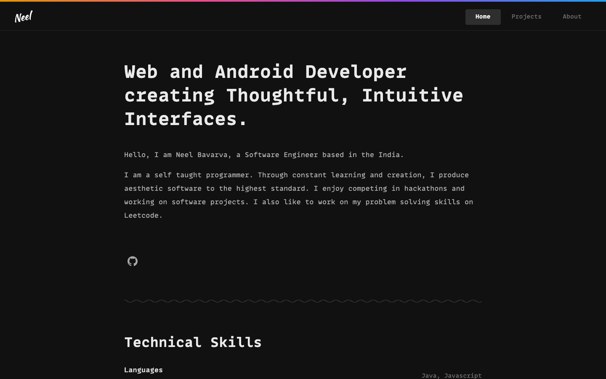
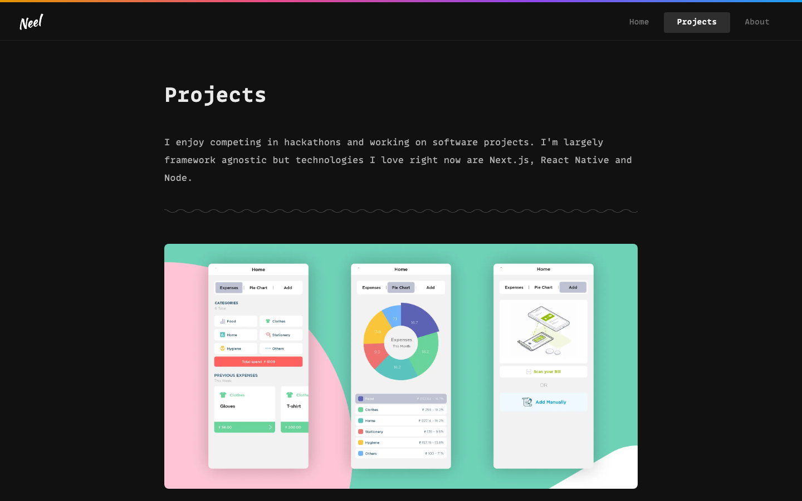
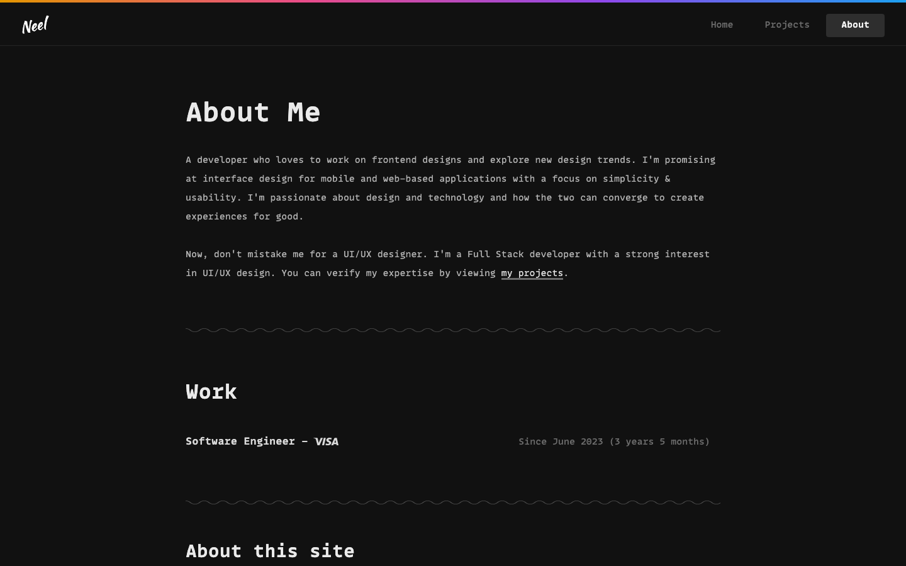
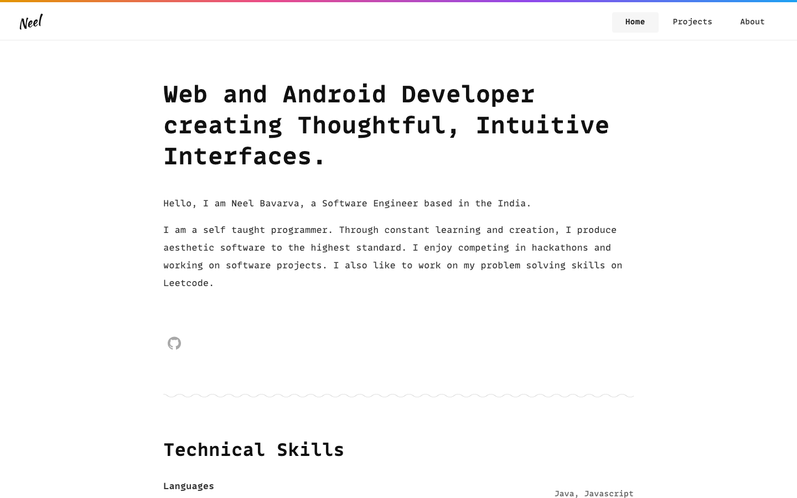

<div align="center">

# Portfolio

A minimal personal portfolio website built with Next.js.

  

</div>

<table>
  <tr><th>Home</th></tr>
  <tr><td></td></tr>
</table>

## About

A three-page personal website with a clean, monospace design. The home page introduces me and my technical skills, the projects page showcases featured work and older archived projects, and the about page covers work experience and how the site itself was built. The site follows the visitor's system theme, so it switches between light and dark mode automatically.

## Screenshots

| Projects | About | Light theme |
| :---: | :---: | :---: |
|  |  |  |

## Features

- **Home**: a short introduction and a categorized list of technical skills
- **Projects**: featured project cards with previews, plus an archive of older projects linking to their repositories
- **About**: bio, work experience and an "About this site" section
- **Automatic theming**: light and dark styles driven by `prefers-color-scheme`
- **Custom typography**: self-hosted MonoLisa and KScript fonts
- **Custom 404 page**

## Tech Stack

| Area | Technology |
| --- | --- |
| Framework | Next.js 13 (Pages Router), React 18 |
| Styling | CSS Modules, global CSS variables |
| Images | `next/image` |

## Getting Started

**Prerequisites:** Node.js 16 or later

```bash
cd neelbavarva
npm install
npm run dev
```

Then open [http://localhost:3000](http://localhost:3000).

To create and serve a production build:

```bash
npm run build
npm start
```

## Project Structure

```
.
├── neelbavarva/          # Next.js app
│   ├── components/       # Navbar plus Home, Projects and About sections
│   ├── pages/            # index, Projects, About, 404, _app, _document
│   ├── public/           # fonts, icons and project preview images
│   └── styles/           # CSS Modules and global styles
└── screenshots/          # images used in this README
```
